<picture>
  <source media="(prefers-color-scheme: dark)" srcset="https://raw.githubusercontent.com/yuri-infra/qwen-32k-longctx-train/main/assets/hero-dark.svg?v=5">
  <source media="(prefers-color-scheme: light)" srcset="https://raw.githubusercontent.com/yuri-infra/qwen-32k-longctx-train/main/assets/hero-light.svg?v=5">
  
</picture>

<p align="center">
  <a href="https://yuri-infra.github.io/#longctx"><strong>⚡ Live Simulator ↗</strong></a> &nbsp;·&nbsp;
  <a href="#system-architecture"><strong>Architecture</strong></a> &nbsp;·&nbsp;
  <a href="benchmarks/local_training_benchmark_report.md"><strong>Benchmarks</strong></a> &nbsp;·&nbsp;
  <a href="tests/test_training_all.py"><strong>Tests (8/8)</strong></a> &nbsp;·&nbsp;
  <a href="long_ctx_train/ring_attention.py"><strong>ZigZag Ring</strong></a> &nbsp;·&nbsp;
  <a href="https://github.com/yuri-infra"><strong>← Profile</strong></a>
</p>

<p align="center">
  <code>ZigZag Ring P2P</code> &nbsp;<code>Zero-Atomic Triton FA2</code> &nbsp;<code>Intra-Layer SAC</code> &nbsp;<code>152K Chunked CE</code> &nbsp;<code>Pinned DMA</code> &nbsp;<code>HybridCPUAdamW</code>
</p>

# qwen-32k-longctx-train · 长上下文大模型训练与分布式 ZigZag 环形注意力引擎

本工程加载本地真实预训练 **`Qwen/Qwen2.5-0.5B-Instruct`**（`494.0M` 参数，`24` 层，`Hidden=896`，`Inter=4864`，GQA `14Q/2KV`，`Vocab=151,936`，`BF16`），在单张 **RTX 5060 Laptop GPU（7.93 GB GDDR7）** 上完整构建并实测了 **自定义 Triton GQA FlashAttention-2 前反向算子**、**`torch.distributed` 多进程 ZigZag 负载均衡 Ring Attention**、**层内细粒度选择性激活重计算（SAC）**、**槽位安全锁页内存池与双缓冲跨层异步卸载预取**、**大词表原地 `addmm_` 全序列流式分块交叉熵** 以及 **主机内存 FP32 主权重混合精度优化器（`HybridCPUAdamW`）**。

---

## System Architecture

<picture>
  <source media="(prefers-color-scheme: dark)" srcset="https://raw.githubusercontent.com/yuri-infra/qwen-32k-longctx-train/main/assets/arch-dark.svg?v=5">
  <source media="(prefers-color-scheme: light)" srcset="https://raw.githubusercontent.com/yuri-infra/qwen-32k-longctx-train/main/assets/arch-light.svg?v=5">
  
</picture>

---

## 1. 模块结构与阅读路径

```text
qwen-32k-longctx-train/
├── README.md                                        # 架构说明、运行命令与实测指标摘要
├── long_ctx_train/
│   ├── __init__.py                                  # 对外导出符号与计数器接口
│   ├── flash_attn_triton.py                         # [算子层] Triton GQA FlashAttention-2 前反向（O(S) LSE、零 atomic_add dK/dV 归约、显式位置因果掩码与严格契约校验）
│   ├── ring_attention.py                            # [分布式层] 真实 torch.distributed P2P 环网通信（保活异步锁页接收缓冲）+ ZigZag 对称分片与在线 FP32 LSE 合并
│   ├── activation_offload.py                        # [存储层] 槽位追踪 PinnedActivationPool（零回绕覆写）+ 双缓冲异步 D2H 卸载与反向超前一层 H2D 预取
│   ├── selective_checkpoint.py                      # [重算与损失层] 层内选择性重算 SAC / 单趟无冗余解析反向卸载层（兼容 LoRA 局部冻结）+ 原地 addmm_ 流式分块交叉熵
│   └── trainer.py                                   # [系统层] 真实 Qwen2.5-0.5B-Instruct 权重加载、AdaptiveHybridMemoryPlanner 与兼容非连续步长的 HybridCPUAdamW
├── tests/
│   └── test_training_all.py                         # 8 项回归与对抗测试（多精度/非连续视图、契约/越界拦截、mp.spawn 环网、锁页篡改与 LoRA 冻结、分块 CE 峰值契约、16K 收敛闭环、AST 审计）
└── benchmarks/
    ├── bench_training_e2e.py                        # 强基线（原生 SDPA）公平对照、配对 ABA 双流掩盖率与连续 2 步稳态最大无 OOM 序列探测脚本
    └── local_training_benchmark_report.md           # 本机 GPU 自动生成的实测性能报告
```

---

## 2. 一键验证与评测命令

```bash
cd qwen-32k-longctx-train

# 1. 运行全部 8 项单元测试（开启 -W default 警告检查）
python3 -W default tests/test_training_all.py

# 2. 运行真实 24 层 Qwen2.5-0.5B-Instruct 端到端 ABA 评测与连续 2 步稳态 32K 容量边界探测
python3 -W default benchmarks/bench_training_e2e.py
```

---

## 3. 核心工程设计与实测结果摘要（RTX 5060 7.93 GB · 真实 24 层 `Qwen2.5-0.5B-Instruct`）

1. **强基线对称对齐与层内选择性重计算（`SAC`）**：
   - 所有对照基线底层均使用 PyTorch 原生 `F.scaled_dot_product_attention(is_causal=True, enable_gqa=True)`（FlashAttention-2），并对称共享单 Pass 融合 `RMSNorm`、`RoPE` 与 `SwiGLU` 算子（杜绝 $O(S^2)$ 稻草人基线与算子不对称偏差）。
   - `SelectiveLayerCheckpointFunction` 前向仅保留紧凑注意力边界张量 `(x, q_r, k_r, v, attn_out, lse, h_mid)`，丢弃占层激活逾 80% 的宽维 SwiGLU 中间态，在反向阶段直接利用 `LSE` 求注意力导数，跳过注意力前向及 `Q/K/V/O/Down` 投影重算。无优化器前反向口径下，`SeqLen = 4,096` 时前向常驻激活从 Eager 的 `3813.0 MB` 降至 **`739.3 MB`**（削减 `80.6%`），总显存峰值 `2556 MB`，有效吞吐达 **`15.13 TFLOPS`**（`945.4 ms`，优于 `Full Checkpointing` 的 `961.8 ms` / `14.87 TFLOPS`）。
2. **大词表全序列原地 `addmm_` 流式分块交叉熵（零截断）**：
   - 完整计算全序列全部 `S - 1` 个位置的自回归交叉熵损失（经 AST 审计杜绝任何尾部截断切片），采用原地 Softmax、`2^-3` 指数预缩放防 FP16 下溢以及 cuBLAS **`dw_f32.addmm_`** 原地累加词表梯度（消除 `[V, H]` 低精度分块临时张量与二次转型拷贝）。
   - 在 `M = 16,384, Vocab = 151,936 (BF16)` 实测下，反向额外工作区显存压降至 **`520.0 MB`**（含返回梯度张量的总增量峰值为 **`872.0 MB`**，对比未分块路径的 `~13.9 GB` 削减逾 `93%`），并在反向入口第一时间回调 `trigger_prefetch_latest()` 将最后一层卸载激活的 H2D 预取隐藏在 `151,936` 词表反向 GEMM 之内。
3. **槽位安全锁页池、单趟解析反向卸载与真实消费激活的双流 DMA 掩盖**：
   - `PinnedActivationPool` 显式追踪槽位 `in_use`、`d2h_done_event` 与 `h2d_consumed_event`（满池时安全扩容或在 `strict_capacity=True` 下抛出 `MemoryError` 拒绝环绕覆写）；`OffloadedLayerCheckpointFunction` 在反向阶段单趟恢复注意力中间态并直接执行 `_layer_analytical_backward`（每层总计仅算 2 次 SwiGLU，且按 `ctx.needs_input_grad` 原生兼容 LoRA / 局部参数冻结）。
   - 在全部 24 层激活 100% 被反向求导真实消费的路径上（由 `test_03` 清零锁页缓冲篡改实验核实），`B=4, S=2048`（单步往返传输 `672.0 MB`，纯 PCIe 裸耗时 `52.47 ms`）5 轮配对三元组 ABA 实测从同流串行 `1225.64 ms` 降至双流异步预取 **`1170.31 ms`**（节省 **`55.33 ms`**，基本掩盖物理 PCIe 往返延迟）。
4. **单张 8GB 显卡连续 2 步稳态训练闭环（`Fwd + Full-Seq Loss + Bwd + 常驻优化器 Step 2`）容量阶梯**：
   - 探针强制连续运行 2 个完整训练步（Step 1 完成优化器动量分配，Step 2 检验优化器状态常驻显存下的真实稳态峰值；例如 `SeqLen = 2,048` 无优化器前反向峰值为 `6519 MB`，叠加标准 GPU `AdamW` 常驻动量 `~1.88 GB` 后在 Step 2 超出 8GB 触发 OOM）：
   - 标准 PyTorch 基线（`SDPA + 全词表 CE + 标准 GPU AdamW`）：稳态最大 **`1,024` tokens**（`1.0x`）；
   - 流式损失 + 主机主权重优化器（`SDPA + 分块 CE + HybridCPUAdamW`）：稳态最大 **`4,096` tokens**（`4.0x`）；
   - 纯 GPU 选择性重算（`Triton Flash2 + SAC + 分块 CE + HybridCPUAdamW`）：稳态最大 **`24,576` tokens**（`24.0x`）；
   - 混合异步卸载全状态（`Triton Flash2 + 双缓冲异步卸载预取 + 分块 CE + HybridCPUAdamW`）：稳态最大 **`32,768` tokens**（跑满 `Qwen2.5` 完整原生 `32K` 上下文窗口，实现 **`32.0x`** 稳态上下文拓展）。
5. **真实多进程（`mp.spawn`）ZigZag 对称负载均衡 Ring Attention**：
   - 基于 `torch.distributed.batch_isend_irecv` 在独立子进程间沿环路异步传递 `(K, V, dK, dV)` 并以 FP32 在线合并 `LSE`（`gloo` 异步线程强引用保活主机锁页接收缓冲至 H2D 事件完成）；`world_size=2`、GQA `14Q/2KV` 下与单进程全局 FlashAttention 反向梯度最大绝对误差为 **`8.58e-06`**。
   - 在 `P=4, S=4096` 下，ZigZag 首尾对称分片 `(c_r, c_{2P-1-r})` 将各 Rank 有效因果计算对数的最大/最小比值从顺序切分的 `6.99x` 收敛至严格 **`1.00x`**。

---

## 4. 工程边界与客观权衡

- **纯 GPU `SAC` 与异步 CPU `Offload` 的切换准则**：在单卡显存可容纳紧凑注意力激活的区间（本机 `S <= 24,576`），纯 GPU `sac_triton_flash` 无跨 PCIe 传输且重算比例低，吞吐高于卸载模式；当序列增至 `32,768` 超出纯 GPU 容量时，`AdaptiveHybridMemoryPlanner` 按需将驻留时间最长的浅层切换至双缓冲异步卸载，以掩盖后残余传输与局部重算开销换取单卡大上下文可训性。
- **`HybridCPUAdamW` 的单卡取舍**：将 `12 Bytes/param`（对 `494.0M` 参数共 `5.52 GB`）的 FP32 主权重与一二阶动量置于主机常规内存，配合单块可复用 `64 MB` `pin_memory=True` 暂存区在 `opt_stream` 上流式搬运梯度（兼容连续与非连续参数视图），兼顾了 GPU 零静态优化器显存占用与 WSL2/WDDM 锁页内存配额限制，但每步末尾存在 CPU 侧向量化更新开销；多卡场景下可切换为 ZeRO-1/2 将优化器状态分片驻留于各卡 HBM。
